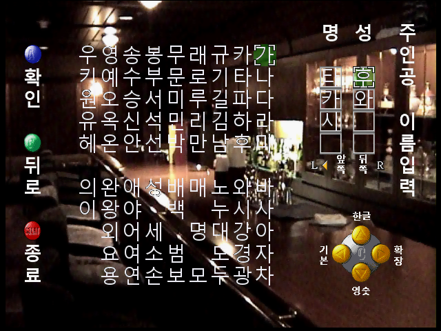
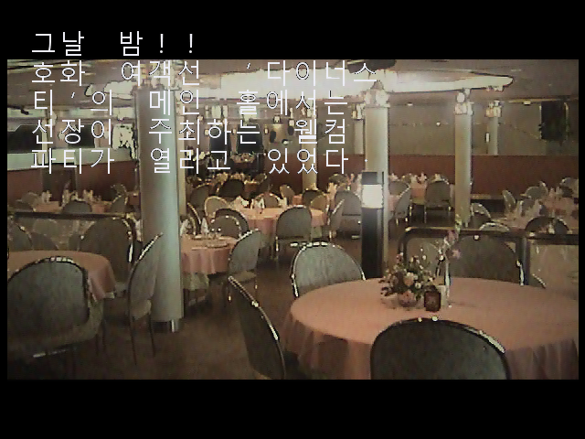
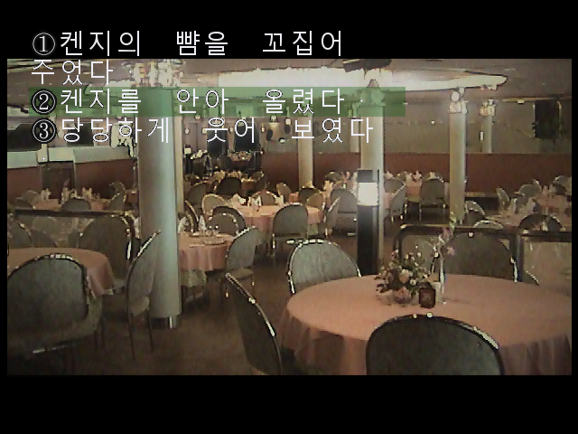
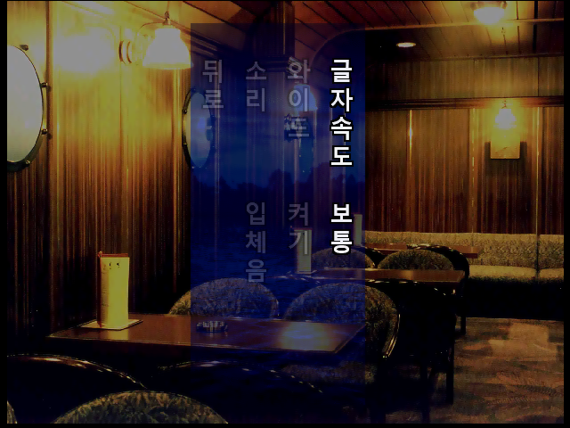
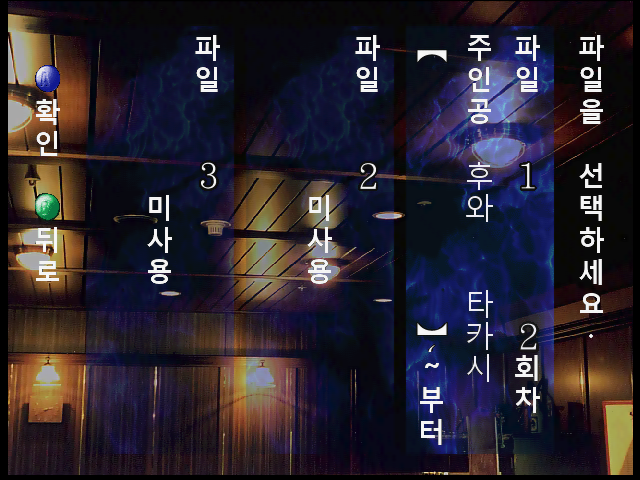

# 야광충 2 한글패치 v1.3

Nintendo 64 일본어판 **Yakouchuu II Satsujin Kouru**용 비공식 한글패치입니다.
본문·선택지·이름 입력·시스템 문구에 **검정 2픽셀 외곽선(C안)**을 적용해 밝은 배경의 가독성을 개선했습니다.

**[최신 한글패치 ZIP 다운로드](https://github.com/ayaneros-eng/yakouchuu-ii-korean-patch/releases/tag/v1.3)**

## Windows에서 쉽게 적용하기

1. `Yakouchuu_II_KO_v1.3.zip`을 다운로드하고 **압축을 모두 풉니다**.
2. **`한글패치 적용.exe`**를 실행합니다. 원본 ROM을 프로그램 창에 끌어 놓거나 **원본 선택**을 누릅니다.
3. **한글패치 만들기**를 누릅니다. 원본과 같은 폴더에 생성된 **`[KO v1.3].z64`**로 게임을 실행합니다.

설치·관리자 권한·Python·인터넷 연결이 필요 없습니다. EXE와 BPS는 압축을 푼 같은 폴더에 두세요.
원본을 덮어쓰지 않으며, 원본·패치·완성 파일의 해시를 검사합니다.
`.z64`·`.n64`·`.v64`의 바이트 순서를 파일 내용으로 확인해 자동 정규화합니다. 이름만 바꿀 필요가 없습니다.
지원 원본은 아래 해시와 일치하는 **32 MiB 일본어판**이며, 이미 한글패치된 ROM에는 적용하지 않습니다.

## 다른 환경 / 일반 BPS 도구

Python 3 사용자는 ZIP의 `reproduce` 폴더 도구로도 적용할 수 있습니다.

```text
python -X utf8 -B reproduce/apply_verified_patch.py ORIGINAL.n64 --output Yakouchuu_II_KO_v1.3.z64
```

일반 BPS 적용 도구에서는 바이트 순서가 정규화된 원본 `.z64`와 `Yakouchuu_II_KO_v1.3.bps`를 사용하세요.

| 항목 | SHA-256 |
|---|---|
| 원본 (정규화된 z64) | `c6a52c2377f3d6236ba2d29557461b9af106d99afeba2156e21e2477b00ddffd` |
| 완성 ROM (64 MiB) | `165fc7678b7cd74cb90cf5609adb5d8dbab6ca3dc58974c11ac5af195bdb326c` |
| BPS | `6236d48fcfb304bcaec0fb90821f53eed2404bc4f49e921605771eadb8860afd` |

## 플레이 안내

- 본문 진행·선택 확정: N64 A 버튼 / 선택지 이동: 좌·우 / 이름 입력 완료: START
- **v1.2 ROM에 덧붙이는 패치가 아닙니다. 일본어 원본에서 새로 적용하세요.**
- 이전 빌드의 세이브스테이트 대신 새로 부팅하세요.
- `Y·O 누구?`는 원작에 등장하는 이니셜 단서입니다.

## 검수와 배포 구성

새 빌드 콜드부팅, 이름 입력, 밝은 배경 본문, 선택지 이동·확정, 설정, 저장을 확인했습니다.
본문 33페이지·1,549글자 검사에서 넘침·글자 소실 후보 0건, 실사용 글리프 1,182개에서 누락 0건입니다.
대사·분기·실행 코드와 리소스 테이블은 v1.2와 같습니다. 이전 v1.2의 7개 주요 결말 검수와 구분하며,
이번 v1.3에서는 모든 분기와 실제 N64 하드웨어를 재검수하지 않았습니다. [검수 보고서](QA_REPORT.md)를 참고하세요.

배포 ZIP에는 차분 패치, 오프라인 간편 적용기와 소스, Python 도구, 설명서, 해시, 화면 5장이 들어 있습니다.
원본/완성 ROM·개인 저장·개발 로그·로컬 경로·계정 정보는 포함하지 않습니다.
[개인정보 검사](PRIVACY_AUDIT.json)와 [파일 목록](MANIFEST.json)을 제공합니다.
게임의 권리는 원저작권자에게 있으며 이 패치는 비공식 팬 번역입니다.

## v1.3 적용 화면

아래 5장은 최종 v1.3을 에뮬레이터에서 직접 실행해 촬영했습니다.

### 한글 이름 입력



### 밝은 배경의 본문



### 선택지와 커서



### 한글 설정 메뉴



### 한글 저장 메뉴


