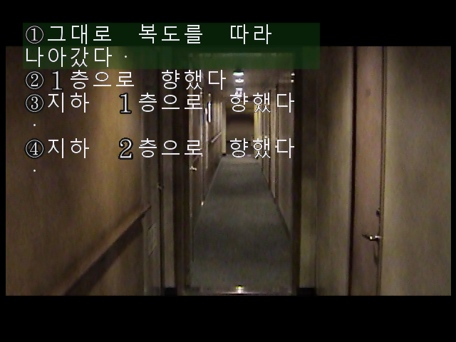

# 야광충 2 한글패치 v1.2

Nintendo 64 일본어판 **Yakouchuu II Satsujin Kouru (Japan)**용 비공식 한글패치입니다.
본문, 선택지, 이름 입력 및 주요 시스템 화면을 한국어로 표시합니다.

**[배포 ZIP 다운로드](https://github.com/ayaneros-eng/yakouchuu-ii-korean-patch/releases/tag/v1.2)**

## 적용 방법

1. 배포 ZIP을 빈 폴더에 풉니다.
2. 소유한 원본 일본어판 ROM을 준비합니다. 아래 SHA-256과 일치하는 32 MiB `.z64`가 필요합니다.
3. Python 3를 설치한 환경에서 다음 명령을 실행합니다.

```text
python -X utf8 -B reproduce/apply_verified_patch.py ORIGINAL.z64 --output Yakouchuu_II_KO_v1.2.z64
```

도구는 원본·패치·결과의 해시를 확인하고 원본 덮어쓰기를 거부합니다. 결과는 64 MiB입니다.
일반 BPS 적용 도구에서도 `Yakouchuu_II_KO_v1.2.bps`를 사용할 수 있습니다.
파일명을 바꾸어도 바이트 순서가 다른 `.v64`·`.n64`가 `.z64`로 변환되지는 않습니다.

| 항목 | SHA-256 |
|---|---|
| 원본 | `c6a52c2377f3d6236ba2d29557461b9af106d99afeba2156e21e2477b00ddffd` |
| 패치 적용 결과 | `2109f2fdd80e31d6e894b2d64fc4bb748eb73b7ef311a64b28d66025b9263fa1` |
| BPS 패치 | `234bab519a16a7eff64a35ba0bbca9ff30ae01a50d77f9fd92d50e57c6f9d860` |

## 플레이 안내

- 본문 진행: N64 A 버튼
- 선택지 이동: 방향키 좌/우, 확정: A 버튼
- 이름 입력 완료: START 버튼
- 이전 패치의 세이브스테이트를 재사용하지 말고 새로 시작하세요.
- 후반의 `Y·O 누구?`는 원작에 등장하는 이니셜 단서를 묻는 문구입니다.

## 검수 범위

기존 검수는 주요 결말 4계열·7개와 본문 4,391페이지를 대상으로 했습니다.
2026-10-14에 최종 배포 후보의 부팅·한글 입력·본문·선택지·후반부·엔딩·저장 경로를 추가 확인했습니다.
이번에는 모든 분기를 반복하지 않았습니다. 상세 범위와 한계는 [QA_REPORT.md](QA_REPORT.md)에 기록했습니다.
실제 N64 하드웨어 구동은 미검증이며 에뮬레이터에서 확인했습니다.

## 배포 파일

이 저장소와 배포 ZIP은 BPS 차분 패치, 적용 도구, 안내문, 해시 및 검수 요약으로 구성합니다.
원본 ROM, 패치 적용 ROM, 개인 저장 파일, 개발 인계 압축 및 원시 검수 로그는 포함하지 않습니다.
배포 파일의 개인정보·메타데이터 검사 결과는 [PRIVACY_AUDIT.json](PRIVACY_AUDIT.json)에 있습니다.

게임의 권리는 원저작권자에게 있습니다. 이 패치는 비공식 팬 번역입니다.

## 한글패치 적용 화면

최종 v1.2를 에뮬레이터에서 실행해 캡처한 화면입니다.

### 1. 한글 이름 입력


### 2. 한글 본문


### 3. 3지선다 선택지


### 4. 4지선다 선택지



### 5. 한글 저장 메뉴


